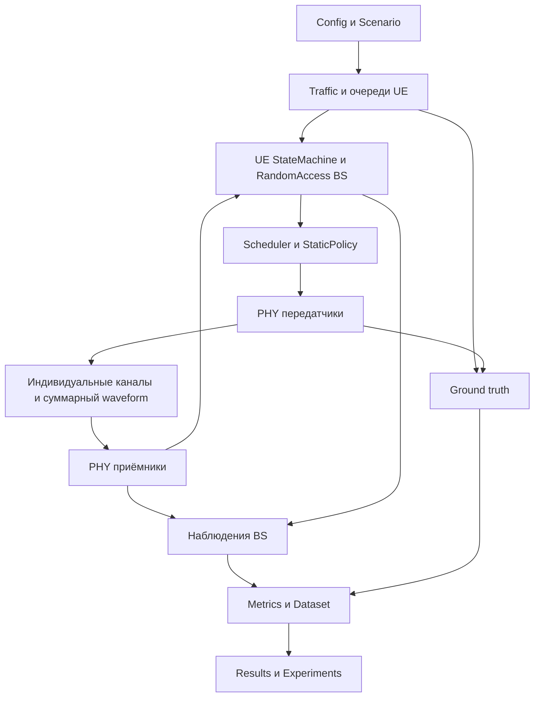

# Архитектура симулятора NB-IoT

Дата: 2026-10-01. Статус: архитектура для детального планирования; реализация не начата.

Первая версия реализует ядро симулятора, фиксированную политику Static и сбор данных в MATLAB R2025b с LTE Toolbox. Архитектура поддерживает последующее подключение ML и адаптивного управления. По поручению пользователя параметры, отсутствующие в ТЗ, выбраны как проектные решения в [базовом профиле](model-profile.md). Повторное согласование каждого параметра не требуется. Текущий этап — только проектирование и планирование.

Источник требований: [ТЗ NB-IoT](../ТЗ_NB-IoT_обновленный.pdf), 36 страниц. Рабочая текстовая копия: `tmp/pdfs/tz-extracted.txt`. Ссылки ниже на параграфы относятся к этому ТЗ.

## Объём первой версии

| Входит | Основание |
|---|---|
| Геометрия одной соты, UE, очереди и состояния | §10–12 |
| Периодический, пуассоновский и массовый трафик | §11 |
| Link budget и индивидуальные радиоканалы | §13, §17 |
| Формирование общего принятого waveform, NPRACH и обнаружение | §14–16 |
| Полная процедура RA: RAR, Msg3, Msg4, таймеры, BACKOFF | §18–19 |
| NPUSCH для Msg3 и пользовательских данных, декодирование и CRC | §20 |
| NPDCCH и NPDSCH для управляющих и нисходящих сообщений | §19 |
| Static с постоянными параметрами и логической долей RA/DT 10/90 | §25–26 |
| KPI, журналы, датасет, воспроизводимые серии запусков | §22, §27–30, §42–43, §47 |

ML, Adaptive-P и Adaptive-RA/DT относятся к следующему этапу согласно уточнению пользователя. GUI предлагается отложить; это допущение проекта, а не исключение из полного ТЗ. Первая версия запускается функцией MATLAB, результаты доступны через таблицы и графики. GUI впоследствии использует те же методы запуска и получения состояния.

Первая версия является согласованным подмножеством полного ТЗ. Критерии готовности полного проекта из §50 не применяются к ней целиком.

## Выбор способа реализации

Рекомендуется модульный MATLAB-проект с пространством имён `+nbiot`, одним объектом управления экспериментом `NBIoTSimulator` и вычислительными функциями внутри модулей. Это соответствует §45 и позволяет скрыть работу LTE Toolbox за небольшими интерфейсами.

Набор скриптов годится для отдельных примеров PHY, но требует ручного управления состоянием и зависимостями при полном обслуживании UE. Simulink потребовал бы дополнительного продукта и отдельного обоснования реализации массового доступа. Для текущего объёма обычный MATLAB достаточен.

Изменяемые состояния UE хранятся в заранее выделенных типизированных массивах, журналы — в наращиваемых буферах с последующим преобразованием в `table`. Отдельный объект на каждое UE не требуется. Сложные состояния декодирования выделяются только для активных передач.

## Модули и владение состоянием

| Модуль | Ответственность и принадлежащие данные | Основной интерфейс |
|---|---|---|
| Config | Проверенные входные параметры, единицы, PHY-профиль | `validateConfig(cfg)` |
| Scenario | Геометрия и неизменяемые внешние условия запуска | `buildScenario(cfg)` |
| Randomness | Детерминированные внешние воздействия и отдельные решения UE | Выборка по источнику, UE и абсолютному времени |
| SimulationEngine | Модельное время, очередь событий, порядок исполнения | `run(untilTime)`, `step()`, `stop()` |
| Devices и StateMachine | Протокольное состояние UE, таймеры, идентификаторы попыток | `advanceDevices(state, events, now)` |
| TrafficGenerator и PacketStore | Поступления пакетов, очереди и состояние доставки | `arrivals(now)`, операции очереди и сборки пакета |
| LinkBudget | Потери, принимаемая мощность, параметры шума | `evaluateLinks(cfg, scenario)` |
| RadioChannel | Каналы UL/DL, задержки, CFO, состояние фильтров, суммирование | `propagateBatch(txBatch, timeRange)` |
| PHY | Генерация, оценка канала, обнаружение, декодирование | `buildTransmission(grant, payload)`, `receive(rxWindow)` |
| RandomAccess | Состояние процедуры на BS, RAR, временные идентификаторы, разрешение конкуренции | `handleRaEvents(events, now)` |
| Scheduler | Календари UL/DL, очереди запросов, допустимость назначений | `schedule(requests, calendar, decision, now)` |
| StaticPolicy | Постоянная вероятность доступа и профиль распределения ресурсов | `decide(observation, currentConfig, now)` |
| Metrics и Dataset | Накопители KPI, окна наблюдений, отдельная разметка истины | `consume(events)`, `closeWindow(tStart, tEnd)` |
| Experiments и Results | Серии реализаций, экспорт, метаданные среды, графики | `runExperiment(cfg)`, `saveResult(result, folder)` |

Объект `NBIoTSimulator` связывает модули и предоставляет внешние методы `run`, `step`, `snapshot`, `stop`, `result`. Внутри него нет алгоритмов обнаружения, расчёта канала и определения коллизий.

UE и BS имеют отдельные протокольные состояния. Истинный результат физического анализа не переводит UE в BACKOFF напрямую: переход определяется принятым сообщением или истечением таймера. `RA_PROCESSING` из §12 означает ожидание обработки, а не доступ UE к скрытому результату BS.

## Поток данных



Приёмники и политика управления получают только разрешённые наблюдения. Ground truth используется для диагностической разметки и вычисления исследовательских KPI. Обратного пути от разметки к приёмнику или StaticPolicy нет.

## Время и порядок событий

Системное время задаётся целыми тиками 1 мс, базовая длительность — 5000 тиков. Слоты, символы и отсчёты PHY сохраняют собственную длительность. Начало и окончание waveform задаются абсолютным номером отсчёта и частотой дискретизации; протокольное событие готовности возникает на первом допустимом тике после окончания приёма и обработки.

Предлагается сначала реализовать последовательный цикл из 5000 шагов. Пропуск пустых шагов является последующей оптимизацией и допускается только при сохранении таймеров, окон статистики и канала. Сложный событийный движок на первом этапе не обязателен.

Порядок обработки на одном тике предлагается закрепить так:

1. Завершить передачи и приём, результаты которых готовы к этому времени.
2. Доставить декодированные сообщения адресатам.
3. Обработать истечения таймеров. Сообщение, готовое точно в момент дедлайна, принимается раньше тайм-аута.
4. Добавить новые пакеты и применить правила переполнения и срока жизни.
5. Закрыть завершившиеся окна статистики; сохранить наблюдения и цели.
6. Получить решение политики, действующее только для следующих допустимых назначений.
7. Обновить протокольные состояния, назначить ресурсы и начать новые передачи.

Для событий с одинаковым временем используется стабильный порядок: фаза обработки, тип события, порядковый идентификатор. Каждая попытка имеет `attemptId`; запоздавшие результаты старой попытки не изменяют новую. Успех не может появиться раньше физического окончания передачи.

На границе 5 с обрабатываются уже готовые результаты без запуска новых передач. Все оставшиеся пакеты получают итоговый статус `unfinished`. Политика первой версии не продлевает эксперимент для очистки очередей; продление потребует отдельного режима эксперимента и отдельного знаменателя throughput.

## Контракты обмена

Внутренние записи являются MATLAB `struct`. Большие последовательности записей экспортируются как таблицы. Названия ниже — проектные контракты, а не существующий код. Точные типы и параметры интерфейсов определены в [плане](implementation-plan.md); этот план конкретизирует общие интерфейсы из таблицы модулей.

| Запись | Обязательные поля и инварианты |
|---|---|
| Packet | `packetId`, `ueId`, `createdTick`, `payloadBits`, `sizeBytes`, `deadlineTick`, `status`, `fragmentIds`; идентификатор уникален в реализации |
| RaAttempt | `attemptId`, `ueId`, `packetId`, `occasionId`, `nInit`, `startTick`, `deadlineTick`, `attemptNumber`; счётчик увеличивается при фактической передаче Msg1 |
| ResourceRequest | `requestId`, `direction`, `phase`, `channel`, `earliestTick`, `deadlineTick`, `receiverId`, `payloadRef`, `phyProfileId` |
| Grant | `grantId`, `requestId`, `startSample`, `sampleRateHz`, `durationSamples`, `frequencyAllocation`, `transportBlockBits`, `repetitions`, `phyConfig`, `configVersion`; размеры согласованы с PHY-профилем |
| Transmission | `transmissionId`, `grantId`, `direction`, `waveform`, `sampleRateHz`, `startSample`, `activeRanges`, `txPowerDbm`; связь с UE хранится в стороне передатчика |
| RxWindow | `direction`, `receiverId`, `waveform`, `sampleRateHz`, `startSample`, `knownConfig`; не содержит списка реальных передатчиков и истинных битов |
| NprachDetection | `occasionId`, `nInit`, `metric`, `threshold`, `timingEstimateSamples`, `cfoEstimateHz`; оценка CFO может отсутствовать, если приёмник её не вычисляет |
| DecodeResult | `grantId`, `readyTick`, `hasCrc`, `crcError`, `decodedBits`, `receiverMeasurements`; у UCI без CRC ошибка `NaN`; принятие Msg3 связано с декодированным идентификатором, а не с выбором UE из ground truth |
| ObservationWindow | `windowId`, `startTick`, `endTick`, `features`, `featureSchemaVersion`; только информация, доступная к `endTick` |
| TruthWindow | `windowId`, `targets`, `diagnostics`, `targetSchemaVersion`; отдельно от онлайн-признаков |
| PolicyDecision | `effectiveTick`, `accessProbability`, `resourceProfileId`, `configVersion`; проверяется до применения |

Общие единицы: мощность в dBm в конфигурации и ваттах при масштабировании; частоты в Hz; расстояния в m; длительности протокола в тиках; длины TB в битах. Индексы ресурсов стандарта могут быть нулевыми, индексы MATLAB — единичными. Преобразования выполняются в PHY-модуле и фиксируются именами полей.

## Сценарий и случайные воздействия

Выбрано равномерное размещение по площади кольца с радиусами 10–1000 м. Радиус рассчитывается как `sqrt(rMin^2 + u*(rMax^2-rMin^2))`, угол равномерен на полном круге. Ровно `round(0.30*N)` indoor UE выбираются случайным подмножеством. Это проектная конкретизация открытого в ТЗ распределения.

Координаты, трафик, shadowing, CFO и исходные параметры генерируются один раз на внешнюю реализацию. Поступления сохраняются как расписание. Для шума и fading фиксируются независимые источники и правила адресации по абсолютному времени; для шума DL также учитывается получатель. Изменение числа вызовов PHY не должно сдвигать воздействие на другие UE.

Выбраны независимые потоки `mrg32k3a`, создаваемые через `RandStream.create` для внешних реализаций, и под-потоки для источников, UE и блоков времени. Точное отображение ключей и допустимые диапазоны заданы в профиле и задаче 03 плана. В базовом неподвижном сценарии коэффициенты fading постоянны на весь запуск и не перегенерируются для пакетов. При дальнейшей реализации динамического fading необходимо сохранять временную корреляцию.

Выбор преамбулы и решения UE имеют отдельные источники случайности. Ключом служат UE, абсолютная возможность доступа и тип решения. При одинаковых внешних условиях изменение политики не меняет геометрию, расписание трафика, CFO, fading и шум. Сохраняются seed, алгоритмы генераторов, правила адресации и идентификатор внешней реализации.

## Радиоканал и физический уровень

Используется одна WAVEFORM-модель согласно §62 и §65. Решения об обнаружении и CRC принимаются по сигналу и декодеру. Вероятностная подмена PHY и пороговый выбор победителя по разности мощностей не входят в эту архитектуру.

Каждый UL-сигнал получает собственные потери, fading, задержку и CFO, затем помещается на общую временную ось. Шум BS добавляется один раз к сумме. При DL общий переданный сигнал BS проходит отдельный канал до каждого принимающего UE; шум каждого UE независим.

Для каждого окна используются совместимые частоты дискретизации. Если они отличаются, явный модуль преобразования частоты переносит сигнал вместе с временной привязкой. Нельзя складывать массивы только по совпадению их длины. Перекрытия NPRACH и NPUSCH учитываются общим UL-приёмом, если планировщик разрешает их на разных частотных ресурсах.

Передатчик задаёт мощность по активной части waveform. Нулевая часть периодического буфера не входит в среднюю мощность активной передачи. Поле `NPRACHPower` функции Toolbox означает масштабирование в dB; абсолютная мощность в dBm применяется отдельным согласованным преобразованием. [Документация lteNPRACH](https://www.mathworks.com/help/lte/ref/ltenprach.html).

Модель шума получает температуру, NF и частоту дискретизации. Принята нормировка мощности отсчётов в W и дисперсия белого комплексного шума `k*T*F*Fs`; после фильтрации в полосе B мощность равна `k*T*F*B`. Правило определено в профиле и проверяется аналитическим link budget.

Генератор NPRACH возвращает буфер длиной в период, включая начальные и конечные нули. Период буфера, время фактического занятия ресурсов и время возможности доступа хранятся отдельно. Кэшировать разрешается неизменяемую генерацию waveform, но каждый UE получает свой канал. [Документация lteNPRACH](https://www.mathworks.com/help/lte/ref/ltenprach.html).

### NPRACH

Идентификатор преамбулы в предлагаемом FDD-профиле соответствует начальному индексу поднесущей `NInit` внутри конфигурации NPRACH. Он задаётся вместе с `occasionId` и профилем ресурсов. Независимая дополнительная «преамбула» поверх `NInit` не вводится.

`lteNPRACHDetect` возвращает одного кандидата с максимальным пиком. Поэтому выбран дополнительный банк корреляционных шаблонов всех допустимых `NInit` с поиском CFO и задержки; алгоритм и калибровка порога описаны в профиле. Штатный детектор остаётся эталоном одиночного обнаружения и источником `DetectionPeaks`. Это первое физическое испытание реализации. [Документация lteNPRACHDetect](https://www.mathworks.com/help/lte/ref/ltenprachdetect.html).

Приёмник не получает список выбранных UE индексов для сокращения поиска. Несколько UE с одинаковым `NInit` могут дать один обнаруженный кандидат и один RAR. Все UE, успешно принявшие соответствующий RAR, передают Msg3 на назначенном ресурсе. Разрешение конкуренции определяется декодированным Msg3 и принятым Msg4.

Диагностические признаки разделены: наличие логической коллизии по `(occasionId, profileId, nInit)`, обнаружение кандидата, miss, false alarm, успех RA и capture. Capture для полного доступа означает декодирование и обслуживание одного из конкурентов при совпадении ресурса. При одинаковой преамбуле обнаружение само по себе не устанавливает, какой UE был принят. Физическая коллизия фиксируется как пересечение нескольких передач в одном частотно-временном ресурсе приёмника; ошибка, причинно вызванная интерференцией, не заявляется без контрольного прогона. Журнал отдельно хранит факт пересечения и результат декодирования.

### NPUSCH

Общий модуль обслуживает Msg3 и пользовательские TB. Передача включает кодирование NULSCH, формирование символов и DM-RS, заполнение ресурсной сетки и SC-FDMA-модуляцию. Приём включает синхронизацию, оценку канала, демодуляцию и декодирование. Функция генерации NPUSCH-символов сама по себе не замыкает тракт waveform. [Пример MathWorks](https://www.mathworks.com/help/lte/ug/nb-iot-uplink-waveform-generation.html).

При `lteNULSCHDecode` поле `blkCRC == 0` означает успешную проверку. Внутреннее имя `crcError` сохраняет эту семантику. [Документация lteNULSCHDecode](https://www.mathworks.com/help/lte/ref/ltenulschdecode.html).

Пакет 200 байт содержит 1600 бит полезных данных и отображается на допустимые TB выбранного профиля. Размер TB определяется таблицами профиля и назначением ресурсов, а не произвольным размером массива. При фрагментации журнал хранит `packetId`, `fragmentId`, `tbId`, padding и результат CRC. Пакет доставлен после получения всех частей; повтор TB не увеличивает throughput повторно.

Повторения внутри физической передачи, HARQ и новая попытка RA — разные действия со своими счётчиками. Выбран один HARQ-процесс на UE с сохранением мягкого объединения между четырьмя допустимыми bundle-передачами Data TB. UE узнаёт об успехе или неуспехе через новые/повторные N0 grants и физический receipt последнего TB; CRC BS не является мгновенным внутренним сообщением UE. Доставка на BS и получение receipt UE имеют разные метки времени.

### NPDCCH и NPDSCH

Выбран физический DL с формированием, каналом и декодированием RAR и Msg4; также моделируются grants и необходимая обратная связь. Сообщения содержат минимальные поля для реализуемой процедуры. Полный стек RRC, NAS и подключения к ядру сети не входит в исследовательский профиль. Форматы полезной нагрузки, DCI N0/N1, таймеры и повторы закреплены в [профиле](model-profile.md).

Планировщик учитывает исключённые и обязательные подкадры DL в рамках выбранного профиля. Известная конфигурация соты может задаваться перед запуском; это допущение фиксируется отдельно от процедуры начального поиска соты.

Важное ограничение совместимости: текущая веб-документация MathWorks содержит возможности более новых релизов. Например, поддержка TDD в `lteNPRACH` помечена R2026a. Для целевой R2025b предлагается FDD; набор полей и функций окончательно проверяется в локальной справке R2025b. [История версий lteNPRACH](https://www.mathworks.com/help/lte/ref/ltenprach.html).

## Static и календари ресурсов

UL и DL имеют отдельные календари. Календарь хранит доступные частотно-временные интервалы, резервирования, причины ограничений и получателей. Для NB-IoT FDD UE дополнительно проверяется возможность полудуплексной работы: назначение DL не пересекается с UL того же UE и необходимыми интервалами переключения.

Предлагаемый интерфейс политики — `decide(observation, currentConfig, now)`. Static возвращает постоянную вероятность допуска к Msg1 и один фиксированный профиль ресурсов. Планировщик реализует профиль через допустимые физические назначения, а не через изменение длины waveform задним числом.

**Согласовано пользователем 2026-10-01:** учитывать RA/DT по площади «полоса × время» на окне 500 мс отдельно в UL и DL. RA включает NPRACH, Msg3, RAR, Msg4 и их управление; DT включает пользовательские TB и относящееся к ним управление. Доступная площадь считается после обязательных ограничений. Конкретные назначения дискретны, поэтому результат содержит номинальные 10/90, реально зарезервированные доли и реально использованную площадь. Резервирование нескольких Msg3 на общем ресурсе учитывается один раз в физической occupancy.

Эта трактовка конкретизирует §25. Валидатор проверяет совместимость NPRACH и служебных расходов с квотой. Заимствование другой фазы отключено, округление квоты выполняется вниз до элемента сетки. Запросы обслуживаются по дедлайну, времени поступления и стабильному порядковому номеру; внутри равного дедлайна действует циклическая справедливость. Передача, пересекающая границу окна, учитывается площадью пересечения с каждым окном; её полное назначение проверяется до начала. Связанные grant, waveform и обязательный feedback резервируются вместе.

## Параметры из ТЗ

| Параметр | Значение | Источник |
|---|---|---|
| Радиус и минимальное расстояние | 1000 м и 10 м | §10 |
| Высота BS и UE | 30 м и 1,5 м | §10 |
| Indoor | 0,30 | §10 |
| Число UE | Базовое 1000; серии 100, 500, 1000, 2500, 5000 | §10, §29 |
| Частота и полоса | 900 МГц и 180 кГц | §13 |
| Deployment | Standalone | §13 |
| Максимальная мощность UE | 23 dBm | §13; правило управления мощностью не задано |
| NF BS и температура | 5 dB и 290 K | §13 |
| Shadowing outdoor и indoor | 8 dB и 10 dB | §13; трактовка как стандартных отклонений выбрана в профиле |
| Penetration loss outdoor и indoor | 0 dB и 20 dB | §13 |
| CFO | Нормальное распределение, sigma 50 Гц, предел ±200 Гц | §13, §17; способ ограничения не задан |
| Длительность и шаг | 5 с и 1 мс | §30 |
| Размер пакета и очередь | 200 байт и 10 пакетов | §30 |
| Максимум попыток RA | 8 | §30 |
| Seed | 42 | §30 |
| Static | RA/DT = 10/90 | §26 |
| Период будущего контроллера | 500 мс | §23, §30 |

Период записи датасета выбран 500 мс для совместимости с будущим контроллером; это даёт 10 записей на базовый запуск. Подробные журналы сохраняются независимо от размера окна. Для обучения нужны серии разных нагрузок и независимых внешних реализаций.

## KPI и правила завершения

Формулы ниже конкретизируют знаменатели для первой версии. Числитель, знаменатель и число незавершённых объектов сохраняются вместе с каждой вероятностью. При нулевом знаменателе возвращается `NaN` и отметка отсутствия наблюдений.

| Показатель | Предлагаемая формула |
|---|---|
| Успех RA по завершённым попыткам | Успешные завершённые попытки / все завершённые попытки |
| Успех RA к горизонту | Успешные попытки / все начатые попытки; начатые незавершённые показываются отдельно |
| Доля доставленных пакетов к горизонту | Доставленные пакеты / все созданные пакеты |
| Успех обслуживания завершённых пакетов | Delivered / (delivered + dropped) |
| Вероятность потери к горизонту | Dropped / created |
| Коллизия по UE-попыткам | Msg1-попытки, участвовавшие в совпадении ресурса / все Msg1-попытки |
| Коллизия по ресурсам | Ресурсы с двумя и более UE / занятые ресурсы NPRACH |
| BLER | Ошибочные завершённые декодирования TB / все завершённые декодирования TB |
| Throughput | Уникальные биты полезных данных доставленных пакетов / фактическая длительность эксперимента |
| Задержка | Время доставки минус время создания; среднее и p95 только по доставленным, с их числом |
| Occupancy UL/DL | Площадь объединения фактически занятых ресурсов / доступная площадь соответствующего календаря |
| Средняя очередь | Интеграл числа ожидающих пакетов по времени / длительность, затем усреднение по UE |

BLER Msg3 и пользовательских TB сохраняется отдельно. Повторения не считаются независимыми TB до завершения предусмотренного объединения. Occupancy NPRACH хранится отдельно по обнаруженным кандидатам и по реальной передаче из ground truth.

Длина ожидающей очереди считается без текущего обслуживаемого пакета; отдельно хранятся объём недоставленной работы на BS и локальная незавершённая работа UE. Лимит 10 применяется к локально незавершённым пакетам, включая обслуживаемый и ожидающий receipt. Уже доставленный на BS пакет сохраняет место в локальном UE-контексте до receipt или тайм-аута; UE не освобождает его по скрытому знанию BS. При завершении сохраняется баланс `created = delivered + dropped + unfinished`, включая пакеты, отброшенные при переполнении.

Журналы сохраняют попытки по `attemptId`. Итоги по окнам могут показывать физические события, завершившиеся в окне, но дробь success/attempts не формируется из несопоставимых когорт начала и завершения. Доступны отдельные счётчики начала, завершения и цензурирования.

## Датасет и результаты

Наблюдаемые признаки: число обнаруженных кандидатов, статистики пиков и энергии, доступные оценки CFO/тайминга, результаты CRC, отправленные RAR/grants, известные BS очереди запросов и фактически назначенные ресурсы. Для каждого признака фиксируются источник, момент доступности, единица и способ агрегации.

Истинное число конкурирующих UE, попыток Msg1, логических коллизий и полные очереди UE являются разметкой. В §§21–23 некоторые величины перечислены среди признаков, но §40 прямо запрещает утечку истинного target. Поэтому отсутствие измеримости не заменяется знанием симулятора. Средняя задержка BS может рассчитываться только по доступным временным меткам протокола; полная задержка от скрытого поступления хранится в диагностике.

Primary target: среднее по окну число UE с недоставленным пакетом в `WAIT_RA`, `RA_TX`, `RA_PROCESSING`, `WAIT_RAR`, `MSG3_TX`, `WAIT_CONTENTION_RESOLUTION`, `BACKOFF`. Отдельно сохраняются число UE с любыми недоставленными пакетами и число фактических передатчиков Msg1. Определение фиксируется версией схемы, вместе с признаками и разделением целых реализаций 70/15/15.

Train/validation/test впоследствии разделяются целыми внешними реализациями или сценариями; соседние окна одного запуска не распределяются случайно между обучением и тестом.

Предлагаемая структура `result`:

```text
schemaVersion, runId, externalRealizationId
config, scenario, environment, randomness
ueSummary, packetLog, raLog, phyLog, resourceLog
kpiTimeSeries, kpiSummary
dataset.observations, dataset.targets, dataset.schema
status, stopReason, actualDurationTicks, profiling
```

Основной формат — MAT; таблицы и датасет дополнительно экспортируются в CSV с отдельной схемой. Большие массивы при необходимости сохраняются в MAT v7.3. Полные waveform сохраняются только по выбранным диагностическим окнам. Результат содержит версию MATLAB и Toolbox, версию кода при наличии системы контроля версий, конфигурацию и параметры воспроизведения.

Ошибочные конфигурации останавливают запуск до генерации сценария с кодом и именем поля. При вычислительной ошибке сохраняются доступные журналы, время, идентификатор передачи и статус `failed`; успешное завершение не подменяется частичным результатом.

## Предлагаемая структура файлов

```text
docs/
  architecture.md
  implementation-plan.md
configs/
  baselineStatic.m
  trafficBurst.m
src/
  +nbiot/
    NBIoTSimulator.m
    runExperiment.m
    +config/
    +scenario/
    +randomness/
    +engine/
    +devices/
    +traffic/
    +channel/
    +phy/
      +nprach/
      +npusch/
      +npdcch/
      +npdsch/
    +ra/
    +scheduler/
    +policy/
      StaticPolicy.m
    +metrics/
    +dataset/
    +results/
experiments/
tests/
examples/
results/
```

Это схема будущей реализации. Пустые классы и папки для ML/GUI заранее не создаются. Для расширения достаточно интерфейса политики и схемы наблюдений.

## Принятые проектные решения

| Решение | Выбранное значение | Где определено |
|---|---|---|
| GUI | Следующий этап | Объём первой версии |
| Физический профиль | Cat-NB1 / Release 13, FDD, известная конфигурация, одна неподвижная сота | model-profile.md |
| NPRACH | Format 0, 12 поднесущих, 80 ms, start 8 ms, NRep 1 | model-profile.md |
| NPUSCH | 15 kHz, три тона, Msg3 88 bits, Data 256 bits, NRep 2 | model-profile.md |
| DL | Физические N0/N1, NPDSCH, NRS и обязательные сигналы, ACK Msg4 | model-profile.md |
| Link budget | Log-distance n 3.5, три стационарных Rayleigh-отвода, фиксированные мощности | model-profile.md |
| CFO и задержки | Усечённая нормаль; delay, остаточная синхронизация и TA | model-profile.md |
| Таймеры и повторы | RAR pp10, contention pp16, BACKOFF 256 ms, lifetime 10 s, четыре Data bundle | model-profile.md |
| Соединение | Один RA на пакет, все его TB в одном контексте | model-profile.md |
| Static 10/90 | Раздельные UL/DL квоты, без заимствования, округление вниз | model-profile.md |
| Трафик | Burst 1000–1100 ms всех UE, periodic 1 s, Poisson 0.2/s | model-profile.md |
| Очереди | FIFO/drop-tail, лимит 10 локально незавершённых пакетов, включая обслуживание и receipt | model-profile.md |
| Датасет | Окна 500 ms, раздельные observations/targets, разделение реализациями | model-profile.md |
| Производительность | Измерить pilot, затем оценить стоимость серии; 5000 UE обязательны как целевой масштаб | implementation-plan.md |

Архитектурные интерфейсы, разделение наблюдений и истины, работа с пакетами и TB, а также схема результатов не зависят от численных значений этих параметров. Профиль и план достаточно определены для последующей реализации; текущий запрос её не разрешает. Коррекция параметров по фактической совместимости выполняется с записью причины и версии профиля.

## Критерии первой версии

Для приёмки нужны воспроизводимая полная цепочка от пакета до CRC и статистики, физически обоснованные сценарии нескольких преамбул и совпадения ресурса, отсутствие доступа приёмника к ground truth, постоянная политика Static, сохранение незавершённых пакетов и корректный экспорт. Проверки §31–39 и §42–44 включаются в будущий план; ML и контроллер из соответствующих параграфов не проверяются в первой версии.

Базовая цель — работоспособность при 1000 UE, возможность запуска до 5000 UE и измеренные затраты времени/памяти. Выполнение 100 реализаций на сценарий зависит от ресурсов согласно §29. Скорость расчёта пока не установлена измерениями.

В этом этапе код симулятора и тесты не создавались и MATLAB не запускался. Сообщение о прежней ошибке `File system inconsistency` имеется в переданном контексте; его причина и работоспособность установки R2025b здесь не подтверждались.
